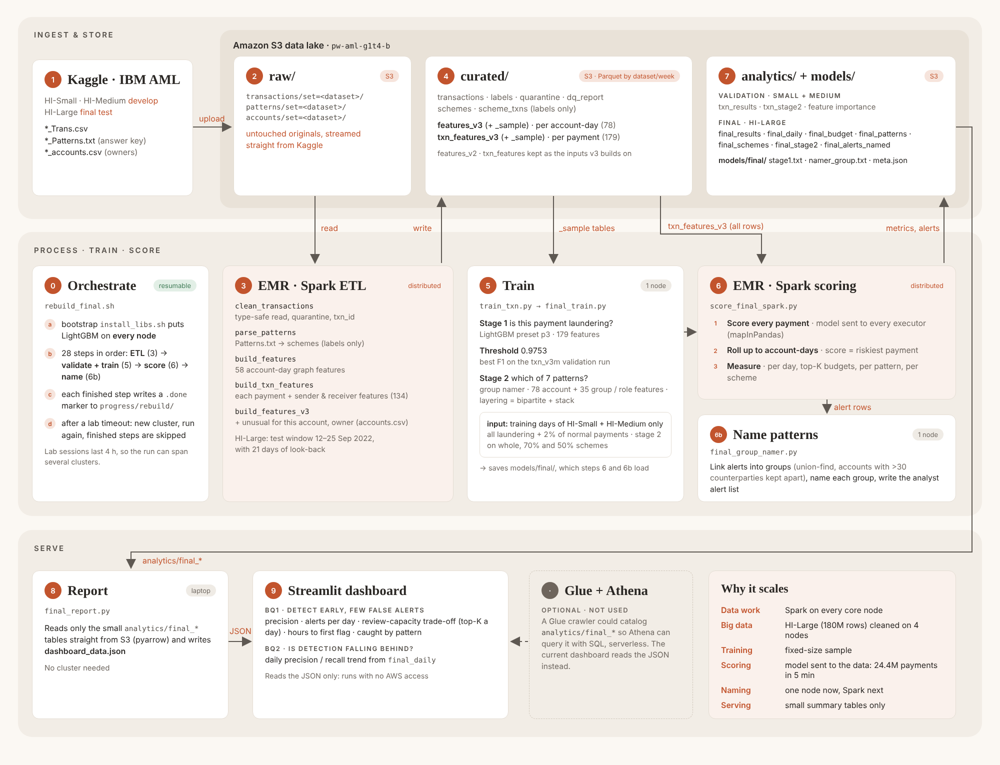
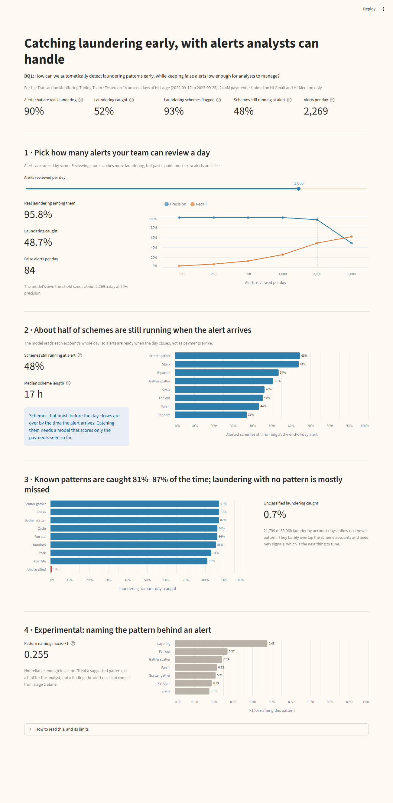

# IS459 G1T4 · BQ1: Early laundering detection

**BQ1:** How can we automatically detect laundering patterns early, while keeping false alerts low enough for analysts to manage?

A two-stage machine-learning pipeline on AWS EMR (Spark) using the IBM AML synthetic dataset:

- **Stage 1 · detection**: LightGBM scores every payment (179 features); an account-day is an alert when its best payment score passes the frozen threshold.
- **Stage 2 · naming**: alerts are grouped with linked accounts, and a second model names the pattern (fan-in, cycle, layering, …).

Trained on HI-Small + HI-Medium, tested once on unseen HI-Large (12–25 Sep 2022).



## Results (HI-Large test)

| | Value |
|---|---|
| Alerts that are real laundering (precision, account-day) | 90.1% |
| Laundering account-days caught (recall) | 52.0% (85.5% for named patterns, 0.7% for unclassified) |
| F1 (validation Small / Medium → test Large) | 0.645 / 0.677 → 0.659 |
| Alerts per day | ~2,269 |
| Schemes flagged | 93.1% |
| Schemes still running when the end-of-day alert arrives | 47.8% |
| Stage 2 macro F1, end to end (experimental) | 0.255 (layering 0.478) |

Full numbers: [`results/final/final_report.txt`](results/final/final_report.txt) and [`results/final/validate_report.txt`](results/final/validate_report.txt).

## Repository layout

```
aml-bq1/
├── pipeline/          the final pipeline: every script rebuild_final.sh runs (keep in one folder; they import each other)
├── experiments/       scripts for the experiment rounds (round 3 steps, diagnostics)
├── app/               Streamlit page for BQ1 (+ its data and theme)
├── results/           report outputs: final test and experiment rounds
└── docs/figures/      pipeline diagram, app screenshot, experiment charts
```

### pipeline/ (in run order)

| Step | Script | Runs on | Does |
|---|---|---|---|
| 0 | `install_libs.sh` | EMR bootstrap action | Installs LightGBM, pandas, pyarrow on every node |
| — | `rebuild_final.sh` | primary node | Runs every step below in order; resumable via S3 markers |
| 1 | `clean_transactions_spark.py` | Spark | Raw CSV → clean transactions + labels |
| 2 | `parse_patterns_spark.py` | Spark | `Patterns.txt` answer key → schemes (labels only, never model input) |
| 3 | `build_features_spark.py` | Spark | Account-day features (v2) |
| 4 | `build_txn_features_spark.py` | Spark | Payment-level features |
| 5 | `build_features_v3_spark.py` | Spark | v3 features (owner, cycles, trends) |
| 6 | `train_txn.py` | primary | Validation run `txn_v3m`: sets the threshold |
| 7 | `final_train.py` | primary | Trains the frozen stage 1 model + group namer |
| 8 | `score_final_spark.py` | Spark | Scores HI-Large; stage 1 metrics, early detection |
| 9 | `final_group_namer.py` | primary | Stage 2: names the alerts, end-to-end grading |
| 10 | `final_report.py` | laptop | Results → `final_report.txt` + `dashboard_data.json` |
| helpers | `group_stage2.py`, `scheme_stage2.py`, `txn_report.py` | — | Imported by the scripts above |

## How to run

**Pipeline (AWS Learner Lab).** Upload `pipeline/` to `s3://<bucket>/scripts/`, create an EMR cluster (1 primary + 4 core `m5.xlarge`, bootstrap action `install_libs.sh`), then on the primary node:

```bash
export AML_BUCKET=<bucket>
aws s3 cp s3://$AML_BUCKET/scripts/ . --recursive
nohup bash rebuild_final.sh > rebuild.log 2>&1 &
```

Step-by-step guide: the BQ1 Final Pipeline Rerun Runbook (team doc).

**Report (laptop).**

```bash
pip install -r requirements.txt
set AML_ROOT=s3://<bucket>          # Windows; export on macOS/Linux
python pipeline/final_report.py HI-Large > results/final/final_report.txt
```

**Streamlit app.**

```bash
cd app
streamlit run app_bq1.py
```



**Stage 2 page (validation only, no HI-Large).** After `group_stage2.py` runs on the cluster:

```bash
set AML_ROOT=s3://<bucket>
python pipeline/stage2_report.py              # leaderboard of every *_grp run, writes app/data/stage2_data.json
cd app
streamlit run app_stage2.py
```

## Data

IBM Transactions for Anti-Money Laundering (Kaggle, `ealtman2019/ibm-transactions-for-anti-money-laundering-aml`). Not stored in this repo: the pipeline downloads it straight into S3.

## Never commit

AWS `credentials`, `.pem` keys, `kaggle.json`. They are listed in `.gitignore`.

## Limits

- HI-Large was tested on a two-week window to fit the lab budget.
- Payments are scored when their day closes, because the features describe the whole day. The `0.0` median hours to first flag and the 97.1% share from first flag in `final_report.txt` assume same-moment scoring, so they are not reported as results.
- Unclassified laundering (no known pattern) is mostly missed.
- Stage 2 over-names layering on HI-Large, so its pattern names are experimental hints.
- Results are not broken down by payment channel.
- Synthetic data: real banks' volumes and patterns will differ.
